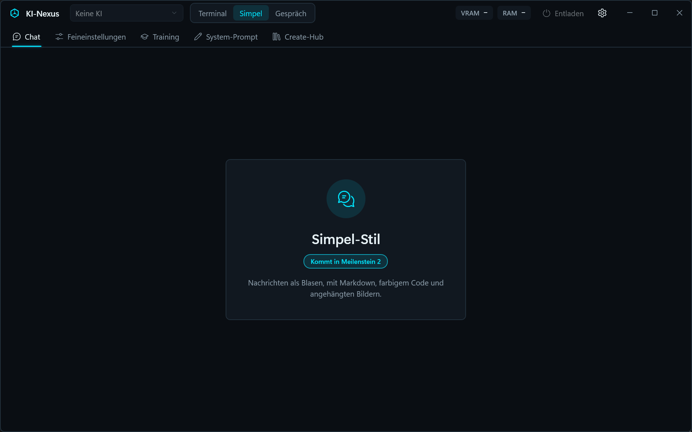

# KI-Nexus

KI-Nexus ist eine Desktop-App für Windows. Damit chattest du mit deinen lokalen KI-Modellen, verwaltest Modelle und baust eigene KIs.
Alles läuft lokal auf dem Laptop: keine Cloud-KI, keine Telemetrie.

> **Stand: Version 0.1.0 (Meilenstein 0 – Gerüst).**
> Das Hauptfenster mit allen Tabs, das Theme und die Einstellungen sind fertig. Chatten geht ab Meilenstein 1 und 2.



## Starten

1. Doppelklick auf **`Start-KI-Nexus.bat`**.
2. Beim ersten Mal baut das Skript die App. Das dauert etwa eine halbe Minute. Danach geht es schneller.
3. Das Fenster vom Skript schliesst sich von selbst, und KI-Nexus öffnet sich.

## Voraussetzungen

| Was | Version | Prüfen mit |
|---|---|---|
| Windows | 11 (10 sollte auch gehen) | – |
| .NET SDK | 10.0 | `dotnet --list-sdks` |

Ab Meilenstein 1 kommen dazu: NVIDIA-Treiber (für llama.cpp mit CUDA) und optional Ollama.

## Für Entwickler

```powershell
dotnet build KI-Nexus.sln            # alles bauen
dotnet test --solution KI-Nexus.sln  # alle Tests
```

Die Solution `KI-Nexus.sln` kannst du mit Visual Studio 2026 oder Rider öffnen.

| Projekt | Inhalt |
|---|---|
| `src/KiNexus.App` | Oberfläche (WPF, MVVM) |
| `src/KiNexus.Core` | Logik ohne Oberfläche |
| `src/KiNexus.Engines` | Anbindung an llama.cpp und Ollama |
| `tests/*` | Unit-Tests (xUnit v3) |

## Tastenkürzel

| Taste | Wirkung |
|---|---|
| `Strg + 1` … `Strg + 5` | Tab wechseln |
| `Strg + ,` | Einstellungen |

## Doku

Die Doku liegt in [`docs/`](docs/), eine Datei pro System. Einstieg: [docs/00-Uebersicht.md](docs/00-Uebersicht.md).
Was sich pro Version geändert hat, steht im [CHANGELOG.md](CHANGELOG.md).

## Daten

Chats, Einstellungen und Logs liegen in `data/`. Modelle liegen in `models/`, Engines in `engines/`.
Diese drei Ordner sind **nicht** in Git, weil sie gross oder persönlich sind. Deine KIs in `kis/` sind in Git und damit gesichert.
