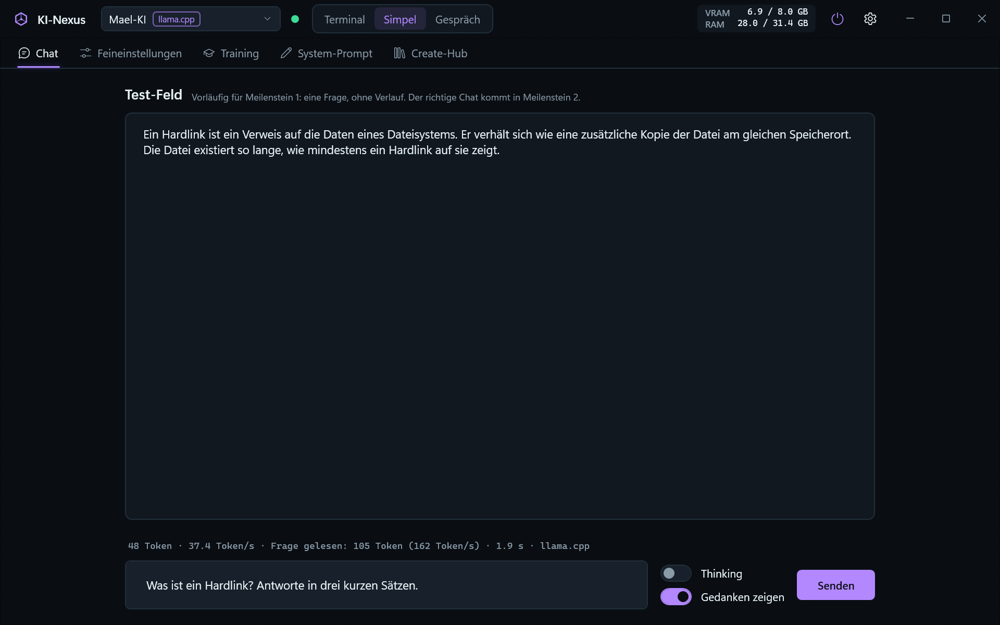

# KI-Nexus

KI-Nexus ist eine Desktop-App für Windows. Damit chattest du mit deinen lokalen KI-Modellen, verwaltest Modelle und baust eigene KIs.
Alles läuft lokal auf dem Laptop: keine Cloud-KI, keine Telemetrie.

> **Stand: Version 0.2.0 (Meilenstein 1 – Engines).**
> Die eigene Engine (llama.cpp) und Ollama laufen. Im Chat-Tab gibt es ein Test-Feld für Fragen. Der richtige Chat kommt in Meilenstein 2.



## Starten

1. Doppelklick auf **`Start-KI-Nexus.bat`**.
2. Fehlt llama.cpp noch, fragt das Skript, ob es llama.cpp herunterladen soll (ca. 560 MB).
3. Beim ersten Mal baut das Skript die App. Das dauert etwa eine halbe Minute.
4. Das Fenster vom Skript schliesst sich von selbst, und KI-Nexus öffnet sich.
5. Fehlt einer KI die Modell-Datei, bietet das Test-Feld „Aus Ollama übernehmen“ an. Das braucht keinen zusätzlichen Speicherplatz (Hardlink).

## Voraussetzungen

| Was | Version | Prüfen mit |
|---|---|---|
| Windows | 11 (10 sollte auch gehen) | – |
| .NET SDK | 10.0 | `dotnet --list-sdks` |
| NVIDIA-Treiber | mit CUDA 13 (getestet: 592.01) | `nvidia-smi` |
| Ollama | optional | Ollama-App |

## Für Entwickler

```powershell
dotnet build KI-Nexus.sln            # alles bauen
dotnet test --solution KI-Nexus.sln  # alle Tests
.\scripts\setup-engines.ps1          # llama.cpp nach engines\ laden
```

Die Solution `KI-Nexus.sln` kannst du mit Visual Studio 2026 oder Rider öffnen.

| Projekt | Inhalt |
|---|---|
| `src/KiNexus.App` | Oberfläche (WPF, MVVM) |
| `src/KiNexus.Core` | Logik ohne Oberfläche |
| `src/KiNexus.Engines` | Anbindung an llama.cpp und Ollama |
| `tests/*` | Unit-Tests (xUnit v3) |

## Tastenkürzel

| Taste | Wirkung |
|---|---|
| `Strg + 1` … `Strg + 5` | Tab wechseln |
| `Strg + ,` | Einstellungen |
| `Enter` / `Esc` im Test-Feld | Frage senden / Antwort abbrechen |

## Doku

Die Doku liegt in [`docs/`](docs/), eine Datei pro System. Einstieg: [docs/00-Uebersicht.md](docs/00-Uebersicht.md).
Messwerte der Engines: [docs/02-Engines.md](docs/02-Engines.md).
Was sich pro Version geändert hat, steht im [CHANGELOG.md](CHANGELOG.md).

## Daten

Chats, Einstellungen und Logs liegen in `data/`. Modelle liegen in `models/`, Engines in `engines/`.
Diese drei Ordner sind **nicht** in Git, weil sie gross oder persönlich sind. Deine KIs in `kis/` sind in Git und damit gesichert.
